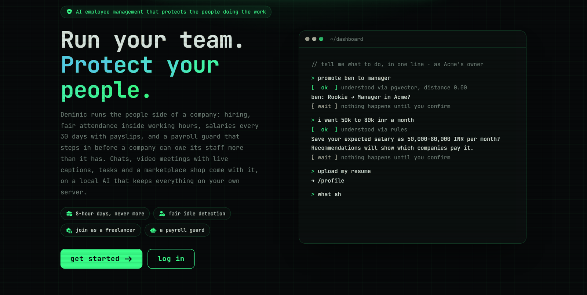
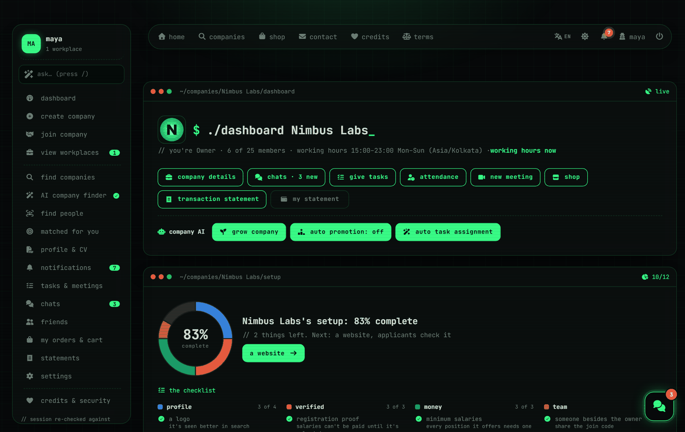
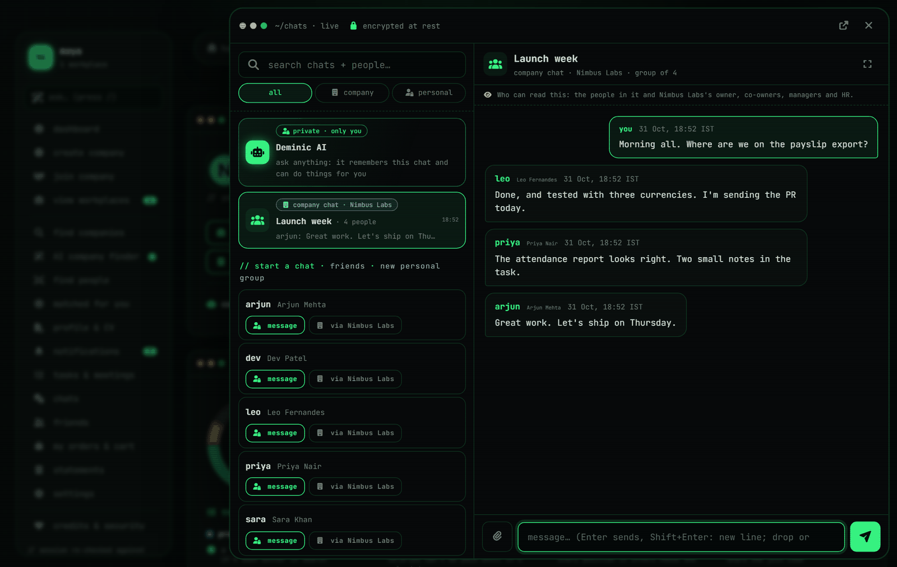
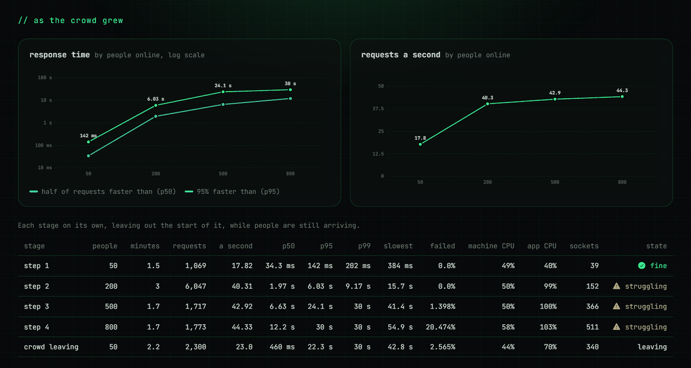
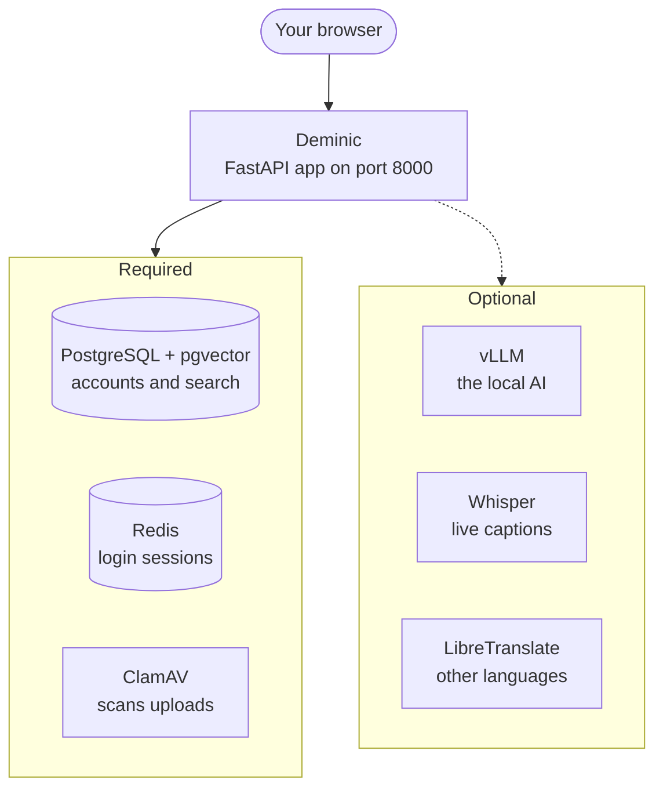

<p align="center">
  
</p>

<p align="center">
  <b>Hiring, attendance, payroll, tasks, video meetings, chats and a marketplace in one app.</b><br>
  It runs on your own machine, with a local AI, so company data stays there.
</p>

<p align="center">
  
  
  
  
  
  
  
</p>

<p align="center">
  <a href="#-quick-start"><b>Quick start</b></a> &nbsp;·&nbsp;
  <a href="#-what-it-does"><b>What it does</b></a> &nbsp;·&nbsp;
  <a href="#-load-test-results"><b>Load test</b></a> &nbsp;·&nbsp;
  <a href="#-how-it-fits-together"><b>How it fits together</b></a> &nbsp;·&nbsp;
  <a href="#-security"><b>Security</b></a> &nbsp;·&nbsp;
  <a href="#-license"><b>License</b></a>
</p>

> [!IMPORTANT]
> **A student project, and not free to use.** It hasn't been audited or certified, and using, copying, hosting or building on it needs the owner's permission first. See the [license](#-license).

<p align="center">
  
</p>

<table>
  <tr>
    <td width="50%"></td>
    <td width="50%"></td>
  </tr>
  <tr>
    <td align="center"><sub>A company's dashboard</sub></td>
    <td align="center"><sub>Chats, one click away on every page</sub></td>
  </tr>
</table>

<sub>The people and the company in these screenshots are made up.</sub>

## ⚡ Quick start

**You need Windows 11 and an internet connection.** Everything else installs itself.

```powershell
git clone <this repository's URL> deminic
```

Then open the `deminic` folder and **double-click `start.cmd`**.

Your browser opens at <http://127.0.0.1:8000> when the app is ready. Close the `start.cmd` window to stop the app, and double-click it again to start it back up.

> [!TIP]
> Running `python app.py`, such as with VS Code's Run button, does the same thing, even with the wrong Python selected.

### What one click sets up

| Step | What happens |
|---|---|
| 🐍 **Python and packages** | Installs uv and Python 3.15 with `winget`, then the app's packages. A working environment is left alone. |
| 🔑 **`.env`** | Makes it from `.env.example` with its own random passwords, and picks your graphics card. An existing `.env` is never changed. |
| 📁 **Folders** | Creates `uploads`, `logs`, `backups` and the built-assets folder. |
| 🐳 **WSL and Docker Desktop** | Installs them if they're missing. Windows asks for permission, and WSL needs one restart: double-click `start.cmd` again afterwards. |
| 🗄️ **Redis, ClamAV, PostgreSQL** | Starts them in containers. The app waits for these three. |
| 🧠 **vLLM, Whisper, LibreTranslate** | Sets them up in a second, minimized window. The app doesn't wait: their buttons turn on once they're ready. |

**Good to know**

- **First run:** ClamAV downloads its virus database, and the AI's image and model are very large, so the AI can take a long time to appear. After each reboot it takes about 4 minutes to start.
- **The local AI** needs an AMD or NVIDIA graphics card with about 16 GB of memory, a current driver, and about 60 GB of free disk space. Without those, the app runs with its AI buttons turned off.
- **Sign-up codes:** until you set up SMTP and Twilio, they're printed in the `start.cmd` window.
- **Maps:** creating a company needs a free [Geoapify](https://www.geoapify.com/) key in `.env`.
- **Admin console:** it stays off until you set `ADMIN_USERNAME` and `ADMIN_PASSWORD` in `.env`.
- **Use `git clone`, not a ZIP.** Windows treats files from a ZIP as downloaded from the internet and may refuse to run `start.cmd`.

## ✨ What it does

<table>
  <tr>
    <td width="50%" valign="top">
      <h3>👥 People and companies</h3>
      <ul>
        <li>Sign-up with email and SMS codes, and an 18+ check</li>
        <li>Positions, joining and leaving approvals, and job offers</li>
        <li>An employee limit each company sets, which only its owner and co-owners can see</li>
        <li>Company search by meaning, CV reading and an AI company finder</li>
        <li>Single company mode, where the whole site runs for one company</li>
      </ul>
    </td>
    <td width="50%" valign="top">
      <h3>🗂️ Work</h3>
      <ul>
        <li>Tasks with deadlines, where the AI can pick up to 5 people</li>
        <li>A calendar with tasks, meetings, holidays and attendance</li>
        <li>Attendance counted only inside working hours, with idle detection and a month view</li>
        <li>Working hours that can change once every 30 days</li>
        <li>Leave requests and colleague reviews</li>
      </ul>
    </td>
  </tr>
  <tr>
    <td width="50%" valign="top">
      <h3>💰 Pay</h3>
      <ul>
        <li>Salary cycles and payslips</li>
        <li>Payments recorded in any currency at the day's rate</li>
        <li>A payroll guard that warns a company, then halts it, if it owes staff more than it has</li>
        <li>Salary money never moves through the app: companies pay from their own bank and record it here</li>
      </ul>
    </td>
    <td width="50%" valign="top">
      <h3>💬 Talk</h3>
      <ul>
        <li>Company and personal chats with files, and a profile one click from any name</li>
        <li>Video meetings with screen sharing, recording, live English captions and AI notes</li>
        <li>Deminic AI, an assistant that streams answers, reads pictures and can search the web</li>
        <li>Nine languages: English, Hindi, Arabic, German, French, Dutch, Spanish, Italian and Chinese</li>
      </ul>
    </td>
  </tr>
  <tr>
    <td width="50%" valign="top">
      <h3>🤖 Company AI</h3>
      <ul>
        <li>A promotion review that can be off, suggest people, or promote by itself</li>
        <li>"Who's best for this task?", ranked from CVs, reviews and work history</li>
        <li>Growth reviews for profiles and companies</li>
      </ul>
    </td>
    <td width="50%" valign="top">
      <h3>🛒 Shop</h3>
      <ul>
        <li>Storefront, search, cart and checkout, with test payments or Cashfree</li>
        <li>Order tracking, delivery codes, returns and buyer reviews</li>
        <li>An AI shopping assistant, review summaries, competitor price tracking and AI-assigned shop tasks</li>
      </ul>
    </td>
  </tr>
</table>

## 📈 Load test results

**Run with Locust on 31 October 2026.** These are the numbers on the app's own `/load-test` page: 10 minutes of simulated people using Deminic at once, with the AI answering at the same time, on one computer.

<table>
  <tr>
    <td align="center"><h3>21,720</h3><sub>requests served</sub></td>
    <td align="center"><h3>96.03%</h3><sub>answered without failing</sub></td>
    <td align="center"><h3>800</h3><sub>most people at once</sub></td>
    <td align="center"><h3>44.33</h3><sub>best requests a second</sub></td>
    <td align="center"><h3>44</h3><sub>AI answers written</sub></td>
    <td align="center"><h3>0</h3><sub>crashes</sub></td>
  </tr>
</table>

<p align="center">
  
</p>

### As the crowd grew

| People at once | Requests a second | Half faster than | 95% faster than | Failed | |
|---:|---:|---:|---:|---:|:---|
| **50** | 17.82 | 34.3 ms | 142 ms | 0% | 🟢 Fine |
| **200** | 40.31 | 1.97 s | 6.03 s | 0% | 🟡 Struggling |
| **500** | 42.92 | 6.63 s | 24.1 s | 1.4% | 🟠 Struggling |
| **800** | 44.33 | 12.2 s | 30 s | 20.5% | 🔴 Struggling |
| **Back to 50** | | 33.5 ms | 151 ms | 0% | 🟢 Recovered, with no restart |

It tops out at about 44 requests a second. That's one worker process at full stretch: past that, more people don't get more done. Everyone waits longer, and a request that has waited 30 seconds counts as failed.

### Is it MVP ready?

**MVP ready: the owner's call.** The bar, set before the test ran, was four checks:

| | Check | Result |
|---|---|---|
| ❌ | Fine at 200 people at once | 95% of requests within 6.03 s (the target was 1 s), 0% failed |
| ✅ | No crash | None in the whole run |
| ✅ | Every data check passed | 14 of 14 |
| ✅ | It recovered by itself | 95% of requests within 0.15 s, 0% failed, no restart |

It passed three of the four. The owner reviewed the result at 200 people and accepted it on 31 October 2026.

<details>
<summary><b>The data and the computer behind these numbers</b></summary>
<br>

**The flood.** Before the test, a database was filled with random data in 45 seconds:

| People | Companies | Shops | Products | Tasks | Colleague reviews | Attendance days | Payslips |
|---:|---:|---:|---:|---:|---:|---:|---:|
| 6,000 | 240 | 140 | 4,275 | 19,979 | 14,311 | 83,124 | 2,369 |

**The computer.** One PC ran the app, the database, the AI and Locust together: an Intel Core i7-12700F (12 cores, 20 threads), 48 GB of memory and an AMD Radeon RX 9060 XT. The app ran as one worker process.

**The AI.** Answers ran on the graphics card through vLLM, up to 8 at once, while the website kept serving everyone else. The median answer took 24.8 s, counted from the question to its last word, including its wait in the queue.

**What this doesn't cover.** It shows how the app held up under load and whether the data stayed right. It isn't a security audit, and real-money payments weren't part of it. The raw Locust report is in [`reports/`](reports/).

</details>

## 🧭 How it fits together



The app runs on your computer and its services run beside it in Docker, all answering on `127.0.0.1` only. If an optional service is down, the app keeps working and turns off what needs it.

| Part | Built with |
|---|---|
| **Backend** | Python 3.15, FastAPI, Uvicorn, async SQLAlchemy, asyncpg |
| **Data** | PostgreSQL 17 with pgvector, Redis 7 (login sessions only) |
| **Frontend** | Jinja templates, MDB UI Kit, Font Awesome, Leaflet, Chart.js |
| **Local AI** | vLLM running Gemma 3 12B on the graphics card |
| **Captions** | faster-whisper (large-v3-turbo) |
| **Translation** | LibreTranslate |
| **File safety** | ClamAV |
| **Load testing** | Locust |

<details>
<summary><b>Ports</b></summary>
<br>

| Service | Port |
|---|---|
| The app | 8000 |
| Redis | 6379 |
| ClamAV | 3310 |
| PostgreSQL | 5432 |
| vLLM (AI) | 8100 |
| Whisper (captions) | 9100 |
| LibreTranslate | 5000 |

</details>

## 🔒 Security

- **Encryption:** AES-256-GCM for bank and ID numbers, and chats encrypted at rest
- **Uploads:** every file is virus-scanned, and pictures are re-encoded to remove their metadata
- **Logins:** one login per account, password rules that refuse common passwords, a limit on wrong sign-up and recovery codes, and an IP ban after 5 wrong admin logins
- **Web:** a nonce-only content security policy, CSRF protection and rate limiting, with an overload log
- **Abuse:** spam protection for chats and both AI assistants, and an admin console with bans and an IP blocklist
- **Database:** the app runs on a login that can only read and write rows
- **Network:** Redis has a password, and every service answers on this computer only

## ⚙️ Configuration

Every setting is in [`.env.example`](.env.example), with a note on what it does. The first run makes your `.env` from it. These are the ones you're most likely to change:

| Setting | What it does |
|---|---|
| `APP_NAME` | The site's name |
| `CONTACT_EMAIL`, `OWNER_NUMBER` | How people reach the owner, shown on the site |
| `PORT` | The port the app listens on (change `PUBLIC_URL` with it) |
| `MAX_COMPANIES_PER_ACCOUNT` | How many companies one account can own at a time |
| `CYCLE_DAYS` | How often salaries are paid, in days |
| `GEOAPIFY_API_KEY`, `GEOAPIFY_SERVER_KEY` | Maps, needed to create a company |
| `ADMIN_USERNAME`, `ADMIN_PASSWORD` | Turns on the admin console |
| `PAYMENTS` | `test`, `cashfree`, or `off` for cash on delivery only |
| `VLLM_GPU` | `amd`, `nvidia` or `none`. Double-click `start.cmd` again after changing it |

Restart the app after changing `.env`.

> [!CAUTION]
> **Keep `.env` safe, and don't change `SECRET_KEY`.** A new key makes saved bank and ID numbers unreadable and hides saved pictures. Your `.env` is ignored by Git and never leaves your computer.

<details>
<summary><b>Project layout</b></summary>
<br>

```text
start.cmd            One click: installs what's missing and starts everything
setup_services.ps1   What start.cmd runs: installs, starts Docker and the services
app.py               Starts the app and its background jobs
system.py            Config, security, sessions, templates, asset build
tables.py            Database models and migrations
form.py              Form models and validation
routers/             Pages and API endpoints
payroll.py, guard.py Salaries and the payroll guard
deminic.py, grow.py  The AI assistant and AI reviews
companyai.py         Promotions and task allotment
shop.py, shopai.py   The marketplace and its AI
meet.py, presence.py Video meetings and live attendance
spam.py, abuse.py    Spam protection and abuse reports
templates/           HTML pages
assets/              CSS and JavaScript sources
static/              Third-party libraries, fonts and images
locales/             Saved translations
reports/             The latest load test, shown at /load-test
vllm_service/        The AI container
whisper_service/     The captions container
docs/                The pictures in this README
myapp/               Python dependencies (uv)
requirements.txt     The same dependencies, for pip
```

</details>

<details>
<summary><b>Installing by hand</b></summary>
<br>

`start.cmd` doesn't need this. If you'd rather use pip, you need Python 3.15:

```powershell
py -3.15 -m venv .venv
.\.venv\Scripts\pip install -r requirements.txt
powershell -ExecutionPolicy Bypass -File .\setup_services.ps1
.\.venv\Scripts\python app.py
```

`setup_services.ps1` makes `.env`, starts the containers and sets up the optional services. It needs Windows, because of Docker Desktop and WSL.

</details>

<details>
<summary><b>Troubleshooting</b></summary>
<br>

**Windows asked me to restart.** WSL needs one restart when it's first installed. Double-click `start.cmd` again afterwards and it carries on.

**It says an Application Control policy blocked a file.** Windows refused to run a file it doesn't trust, and the message names the file. Setup uses python.org's signed Python to avoid this.

**The AI's light stays red.** It may still be downloading: look for the minimized window. If that window has closed, the reason is in `logs/setup_optional.log`. After a reboot the AI takes about 4 minutes to start.

**It says this computer already has a database.** A new `.env` can't open data made with another one. Put your old `.env` back and run `start.cmd` again.

**Port 8000 is taken.** Set `PORT` and `PUBLIC_URL` in `.env`.

</details>

<details>
<summary><b>Known gaps</b></summary>
<br>

- One app process only: rate limits, spam limits, live sockets and the AI queue are held in its memory.
- Cashfree payments and refunds have only been tested against a stand-in server built from Cashfree's documentation, never with real money.
- The NVIDIA option, the AI's model download on a fresh install, and the WSL and Docker Desktop install steps haven't been tested on a fresh PC.
- The load test above ran before the latest round of fixes.
- The test scripts aren't in this repository.

</details>

## 📄 License

All rights reserved. This software is not free to use: using it, copying it, hosting it or building on it needs the owner's permission first. It's provided as is, without warranty, and the owner isn't liable for any damages from using it. The full terms and the owner's contact details are on the app's `/terms` page.
